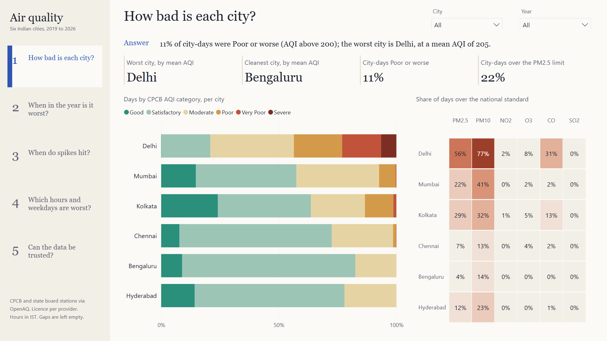

# India Air Quality

Government air-quality monitoring in Delhi, Mumbai, Kolkata, Chennai, Bengaluru and Hyderabad, 2019-01-01 to 2026-09-30, from the public OpenAQ archive. The first piece in this BI series built on real data rather than a simulation: downloaded with a manifest, cleaned with every problem counted, modelled as a star schema in DuckDB, scored with India's CPCB National AQI, tested, and delivered as an Excel workbook and a 5-page Power BI report generated from code.

**[Read the case study (PDF)](docs/case-study.pdf)**, or the [web version](docs/case-study.html). Reviewing the code: **[How it works (PDF)](docs/how-it-works.pdf)** ([web](docs/how-it-works.html)), a fifteen-minute guide to the repo, the rebuild, the checks and the methods.



## Why real data

The earlier pieces simulated their data and graded the analytics against a sealed answer key. Real data has no answer key; instead every number has to survive the source. What that cost here, and what was done:

| Problem | What was done |
|---|---|
| No Indian station data in the archive from 31 Oct 2022 to 19 Feb 2025 (27 months) | Left blank, never estimated; no trend claimed across it |
| Station sets grow (9 of 28 Mumbai stations start in 2025, 8 of 14 Hyderabad stations in 2022) | City averages across years marked as not like-for-like; station-level tables kept |
| NO2, SO2 and CO labelled "ppb" in later files, but the values are CPCB's µg/m³ and mg/m³ | 12,171,979 readings relabelled, not converted; a check retests the evidence every build |
| PM value 985 is an analyser status code (22,707 readings at exactly 985, 15 at 984) | Set aside |
| Frozen sensors: 5,890 runs of one value for 8+ hours | 414,505 readings set aside |
| Two OpenAQ ids publishing different values for one station | 475,812 conflicting readings set aside: no basis to choose |

Nothing is filled, interpolated or estimated. 1,089,800 readings are set aside, each under a named reason.

## Results

| | |
|---|---|
| Stations | 107 (122 OpenAQ ids): Delhi 37, Mumbai 28, Hyderabad 14, Bengaluru 13, Chennai 8, Kolkata 7 |
| Readings | 56,030,781 raw rows; 36,075,426 valid readings of the six AQI pollutants; 7,083 city-days with an AQI |
| Reconciliation checks | 23 of 23 pass; the export is blocked if any fails |
| Mutation test | 23 of 23 deliberate breakages caught |
| Report numbers vs DuckDB | 56 of 56 measures evaluate; 423 of 423 figures match |
| Nothing clipped on the report | 305 of 305 single lines, 36 of 36 wrapped texts, 14 of 14 grids fit |
| Determinism | two builds from the raw files: 18 of 18 output files byte-identical |

## Findings

- Worst city-month: Delhi Nov 2021, mean AQI 401, 30 of 30 days Very Poor or Severe. Worst outside Delhi: Kolkata Jan 2021 at 271.
- Days above the 24-hour PM2.5 standard (60 µg/m³): Delhi 56.5%, Kolkata 29.4%, Mumbai 22.1%, Hyderabad 11.8%, Chennai 6.8%, Bengaluru 3.6%.
- Winter (Jan-Feb) is the worst season, mean AQI 155, against 74 in the monsoon.
- Delhi's October-November PM2.5 runs 3.3x to 5.3x its September. Levels only: no emissions or weather data, so no cause is attributed.
- 79 short PM2.5 spikes, found from the data alone (city PM2.5 at least 2.0x the median of the days 4 to 14 either side, runs of 1 to 3 days): Chennai 28, Delhi 14, Bengaluru 13, Mumbai 12, Kolkata 9, Hyderabad 3. They start most often in October.
- PM2.5 peaks at 22:00 IST across all cities, 1.4x the cleanest hour (16:00).

Every finding with its numbers: [docs/findings.md](docs/findings.md). Source, problems and method: [docs/data-notes.md](docs/data-notes.md).

## What it answers

| Question | Where |
|---|---|
| How bad is each city, month by month? | Report pages 1 and 2; `mart_city_month`; workbook AQI and PM2.5 matrices |
| Which season is worst, and by how much? | Report page 2; `mart_city_season` |
| How many days break the national 24-hour standards? | Report page 1; `mart_exceedance_city_year`, `mart_exceedance_station_year` |
| When do short PM2.5 spikes happen? | Report page 3; `mart_spike_episodes` (rule in `src/config.py`) |
| How much higher is October-November than September? | Report page 3; `mart_octnov_season` |
| Which hours and weekdays are worst? | Report page 4; `mart_profile_hourly` |
| How complete is each station, and what is wrong with the data? | Report page 5; `mart_station_completeness`, `mart_dq_issues` |

## The data

| | |
|---|---|
| Source | OpenAQ archive on AWS Open Data (`s3://openaq-data-archive`), read anonymously over HTTPS: no account, no API key |
| Underlying data | Continuous ambient monitoring stations of CPCB, state boards (DPCC, MPCB, KSPCB, TSPCB, TNPCB, WBPCB), IMD and IITM |
| Attribution and licence | Credit CPCB and the state boards, and OpenAQ. OpenAQ passes on each provider's own licence (the archive lists it as varying by provider); see [docs/data-notes.md](docs/data-notes.md#source) |
| Window | 2019-01-01 to 2026-09-30, hourly, on IST |
| Download | 117,993 daily files, 337.4 MB, each MD5-verified and listed with its SHA-256 in `data/manifest.csv`; per-location summary committed in `reference/manifest_summary.csv` |

## Repo layout

```
src/discover.py            finds Indian stations in the archive (no API key), groups ids into stations, applies the selection rules
src/download.py            idempotent, resumable download with MD5 verification and a manifest; refuses plans over the budget
sql/01_staging.sql         typed readings, IST, canonical units, one disposition per reading (valid or a named issue)
sql/02_model.sql           dim_city, dim_station, dim_pollutant, dim_date; fact_measurement_hourly, fact_measurement_daily
sql/03_marts.sql           CPCB AQI (station and city), month, season, NAAQS exceedance, short spikes, Oct-Nov, profiles, completeness
sql/04_dq.sql              data-quality mart: counts per issue, city, station and pollutant
sql/checks.sql             reconciliation checks; the export is blocked if any fails
src/pipeline.py            builds data/aq.duckdb, runs the checks, exports data/model/*.csv and the workbook
src/mutation_test.py       breaks the data once per check and confirms each check catches it
src/excel.py               excel/india-air-quality.xlsx: summary, month x city matrices, Excel Tables
src/findings.py            recomputes the headline findings into docs/findings.md
powerbi/build_pbip.py      generates the Power BI project (TMDL model, PBIR report) from the warehouse and data/model
powerbi/check_report.py    every number the report shows, recomputed with SQL in DuckDB
powerbi/check_fit.py       no text on the report is clipped, cut off or pushed into a scrollbar
powerbi/*.ps1              open, query, capture and validate helpers for Power BI Desktop
reference/                 station list with every inclusion decision, AQI breakpoints, pollutants, manifest summary
docs/charts.py             case-study charts drawn from the marts
docs/render_docs.py        fills the case study, the reviewer's guide and this README with figures from the warehouse and the build logs
docs/capture_docs.ps1      copies the five report captures into docs/img in reading order
docs/build_pdf.ps1         prints the case study (or -Name how-it-works) to PDF; -Review renders each page to an image
```

## Rebuild it

Requirements: Python 3.12+, about 12 GB free disk (raw files, a 5.4 GB warehouse and a copy of it during the mutation test); Power BI Desktop (free, Windows) for the report.

```bash
python -m venv .venv
.venv/Scripts/pip install -r requirements.txt
.venv/Scripts/python src/discover.py        # optional: reference/stations.csv is committed
.venv/Scripts/python src/download.py        # 337.4 MB into data/raw; resumable
.venv/Scripts/python src/pipeline.py        # warehouse, checks, data/model CSVs and the Excel workbook
.venv/Scripts/python src/mutation_test.py
.venv/Scripts/python src/findings.py
.venv/Scripts/python powerbi/build_pbip.py  # points the report at your data/model folder
```

Open `powerbi/AirQuality.pbip` in Power BI Desktop and choose Refresh. The workbook is written to `excel/india-air-quality.xlsx`. To refresh the docs: `docs/capture_docs.ps1`, `docs/charts.py`, `docs/render_docs.py`, then `docs/build_pdf.ps1` and `docs/build_pdf.ps1 -Name how-it-works`.

## Limits

- The 27-month archive gap splits the record; nothing is said about change across it.
- Station sets grow, so city averages across years are not like-for-like.
- No weather or emissions data: levels and timing are described, causes are not attributed.
- City AQI is the mean of station AQIs, as in CPCB's bulletin; 22 of the 79 spikes are carried by one station of several, and are marked so.
- Power BI has no free public link, so the report ships as a project with images in the docs. The workbook has Excel Tables, not native PivotTables.
